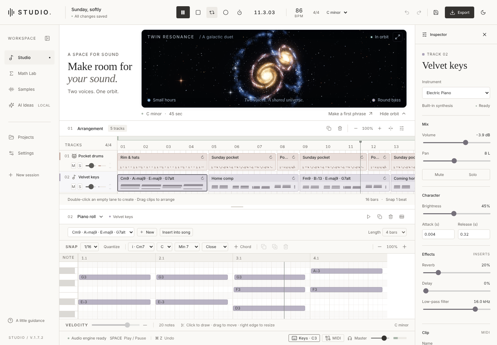
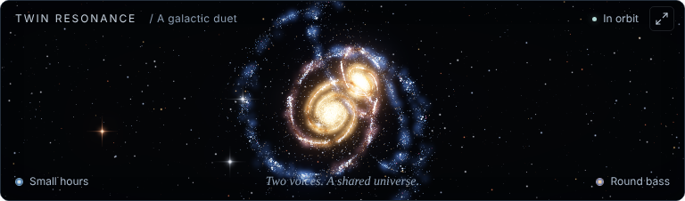
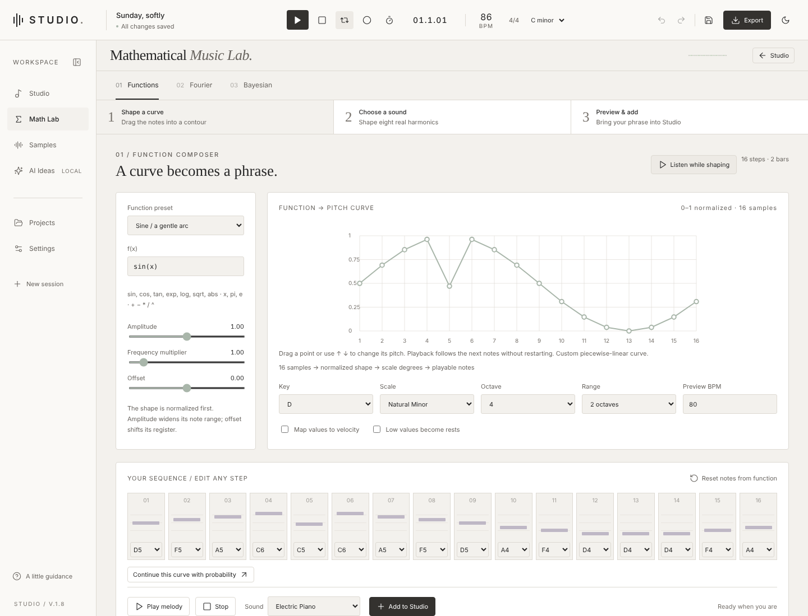
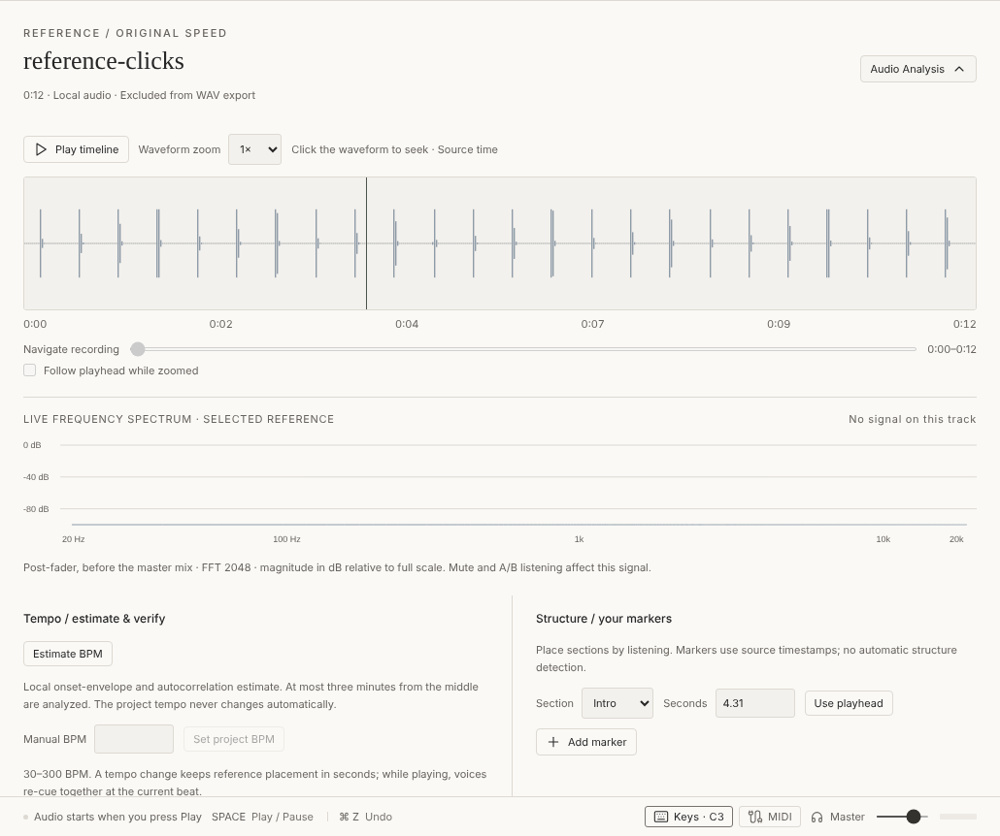

# STUDIO

**A creative playground where mathematics becomes music.**

**[Open STUDIO — music-studio2.vercel.app](https://music-studio2.vercel.app/)**

Publicly accessible in your browser. No login or installation required. Click **Play** to start audio. The site redeploys automatically from `main` on Vercel.

The public website is deployed from this repository. Existing saved sessions stay unchanged; choose **Projects → Open demo session** to hear the latest musical arrangement.

A working browser music studio for composing original R&B, neo-soul, electronic music, and beats. Built with React, strict TypeScript, Tone.js, and Web Audio. No account, paid samples, or AI credentials are needed.



## Twin resonance

Try it on the **[live STUDIO website](https://music-studio2.vercel.app/)**. On shorter windows, choose **Show orbit** above the arrangement to reveal the scene.

**Show orbit** opens a miniature observatory above the arrangement: a binary pair of spiral galaxies that follows the two main audible melodic tracks. The cores orbit their common centre of mass, and the music sets how close they are. The longer and louder the duet plays, and the nearer its two voices move in pitch, the tighter the orbit becomes. By Kepler's third law, a closer pair also turns faster. Each galaxy is made of tens of thousands of simulated stars that orbit their own core and feel the other galaxy's tide, so close passes pull out bridges and tidal tails by themselves. When the music stops, the pair drifts apart and both disks settle back into calm spirals.

Each galaxy also follows its own voice note by note. Every note sends a ripple of light out from the nucleus through the arms. While a note is held, its galaxy glows at a radius set by the pitch: low notes light the golden inner disk, high notes the far arms in ice blue, so a rising line moves light outward along the spiral. Each galaxy rises and sinks with its melodic contour. A leap nudges the pair together (upward) or apart (downward), and when both voices strike a consonance together, the bridge between them flashes. The colours take their cues from photographs of interacting galaxies: golden nuclei, violet-brown dust lanes and blue, clumpy arms.

The scene opens by default on tall windows and remembers **Hide orbit**. Its compact frame works in both themes, with the piano roll kept on screen. Choose **Expand orbit** in a fullscreen-capable browser for a larger view. **Esc** or the minimize button returns to the studio without interrupting playback. System **Reduce motion** shows a still of the resting pair while audio continues, and changes to that preference take effect immediately.

The simulation runs at 30 Hz on the CPU (about 45,000 stars, fewer on machines with four or fewer cores) and is drawn with WebGL2. Browsers without WebGL2 float render targets get the earlier painted galaxies instead. It is a musical visualization built on simplified physics: the stars feel their own galaxy and the companion's tide, but not each other.



## Mathematical Music Lab

Open **Math Lab** from the sidebar to turn functions into editable melodies, shape an eight-harmonic Fourier synthesizer, and build melodies with genuine Dirichlet–Categorical feedback. **Add to Studio** creates normal editable tracks; saved harmonic sounds also appear in the Inspector. Works locally with no API keys, in Gallery Light and Dark.

### Your first phrase in three steps

1. **Shape a curve** — drag one of the 16 points. Your first drag starts a real audio loop; edits change upcoming notes without resetting the playhead.
2. **Choose a sound** — adjust Fourier harmonics, then choose **Use this sound for my curve**.
3. **Preview & add** — listen and choose **Add to Studio** to keep composing on the timeline.

The line artwork now reads the actual master output's waveform and frequency energy. It becomes still when the audio is silent. **Continue this curve with probability** carries the opening into the interactive probability composer; your accepted suggestions supply its evidence.



Read the [Math Lab guide](docs/MATH_LAB.md) for controls, mathematical models, persistence, implementation files, and limitations.

## Reference tracks & Audio Analysis

Import a full song with **Samples → Import Reference**. It appears above your composition with its title, duration and actual waveform. Select its clip to open **Audio Analysis**: zoom and seek the recording, inspect a live frequency spectrum, estimate tempo locally, and place your own Intro / Verse / Chorus / Bridge / Outro markers.

Use **Reference / My Composition / Both** above the arrangement to compare. Reference audio retains its original speed and pitch. Tempo estimates include uncertainty and possible half/double time; only **Set project BPM** changes your session tempo. Reference tracks are excluded from WAV and MIDI exports, while ordinary imported audio still belongs to your composition. Audio stays in your browser and complete `.studio` backups.



See the [Reference Track guide](docs/REFERENCE_TRACKS.md) for full-song import, timing, storage limits, implementation files and verification.

## Run locally

Use Node.js 22.12+ and npm 10+.

```sh
npm ci
npm run dev
```

Open the printed localhost URL (normally `http://127.0.0.1:5173`). Click Play to activate browser audio. Use headphones or keep your output volume comfortable.

```sh
npm run build       # strict TypeScript + production Vite build
npm run preview     # serve the production build
npm test            # domain, editing, persistence, and audio unit tests
npm run test:e2e    # Chrome browser tests, including real audio and WAV analysis
npm run format      # format source and documentation
```

Browser tests use installed Google Chrome locally and bundled Playwright Chromium when `CI=1`. To use bundled Chromium locally, run `npx playwright install chromium` followed by `CI=1 npm run test:e2e`.

## Make a composition

1. The first session opens **Sunday, softly**, an editable 16-bar neo-soul arrangement at 86 BPM: drums, electric piano, bass, pad, and a plucked hook, in four sections (intro, home, lift, close). Press **Play** or Space to hear it. Open **Projects → Create blank project** to start from scratch at 90 BPM.
2. Set the project title, BPM, and musical key in the transport. Key selection highlights the scale and informs new ideas; it never transposes your existing notes.
3. Choose **Add track → Drum Kit**. Toggle the 16 drum steps, set swing, and Alt-click a hit to change its velocity. The editor's Play button previews the pattern in a continuous native-audio loop. Stop preview before returning to the arrangement.
4. Add **Electric Piano**. Click the piano grid to draw notes. Drag notes in time or pitch, drag their right edge to change duration, and Shift-click or Shift-drag to select multiple notes. Use the snap menu, quantize button, and velocity slider. The chord menu lists the seventh chords that belong to the project key (i · Cm7, iv · Fm7, V · G7…) and inserts them in the voicing you choose: close, open, rootless, or shell. Right-click a note to delete it. Scale rows and note names follow the key, so C minor shows E♭ and B♭ rather than D♯ and A♯.
5. Add **Felt Piano**, **Synth Bass**, **Sub Bass**, **Synth Pad**, **Lead Synth**, or **Pluck** for more voices. Each preset starts with a level, reverb, and delay chosen to sit with the others. The bottom keyboard, the computer keys A–L (Z/X for octave) and a connected MIDI keyboard (**MIDI** in the footer) all play the selected track for as long as you hold a note.
6. Arrange clips by dragging them along the timeline. Drag a clip's right edge to trim or extend it. A clip with **Loop source** enabled repeats its source pattern; otherwise an extended clip plays the pattern once and then remains silent. Double-click empty MIDI/drum lanes to create clips.
7. **New** creates a pattern independently of the song. **Insert into song** places it at the playhead. Duplicated clips share the original pattern; use **Inspector → Make independent** before editing a separate variation.
8. Use track **M**/**S**, volume, and Inspector pan, instrument parameters, reverb, delay, and low-pass filter to mix. Reverb and delay are sends into one shared room and one tempo-synced ping-pong delay, so tracks sound like they share a space. Edits made while the song plays take effect without stopping it. Settings contains the arrangement loop start/end; the ruler seeks the playhead.
9. Open **Samples** to preview six original WAV sounds or import WAV/MP3/other browser-decodable audio. Add a sample to an audio track, then trim its source start, set its gain, move it, or loop it. The arrangement shows its actual source waveform.
10. Open **AI Ideas** for three local, editable alternatives. Basslines, melodies, and chord voicings read the chords already in your song at the playhead and follow them (the description says "Follows Cm9 · A♭maj9 · …"); in an empty project they suggest the key's own progression instead. Drum ideas are two-bar grooves with ghost notes and a turnaround, chosen for the tempo. Rhythm variations and phrase continuations work from the selected clip. Preview an idea and choose **Use idea** to add a separate track. Your original notes stay intact.

## Play and record

Arm **Record** (or press R), press **Play**, and play on the computer keys, the on-screen keyboard or a MIDI keyboard. When you stop, the take is added as one undoable edit: notes are quantized to 1/16th, keep their held length, and go into the clip under them or a new "Recorded take" clip. The **Metronome** button adds a click on every beat; it is never exported. With a reference song selected, notes go to your first instrument track so you can play along.

## Save and reopen

Project changes autosave after 700 ms to IndexedDB. **Save** writes immediately. Wait for **All changes saved** before closing the page. **Projects** lists sessions, opens them, creates new ones, and deletes sessions with a confirmation. Reloading restores the last session and its imported audio from the same browser/origin.

Use **Projects → Export complete project** to download one `.studio` file with notes, settings, track instruments and imported audio (up to 256 MB). **Import complete project** validates the audio checksums and restores a separate session, including on another browser. Unapplied Math Lab drafts, learned preferences and unused sound presets are browser preferences, so add a phrase/sound to Studio before backing it up.

**Download project JSON** remains available for notes/settings only. **Settings → Protect local storage** requests browser persistence; the browser may decline it. Clearing site data yourself still deletes local projects, so retain downloaded complete backups.

**Projects → Import MIDI / Export MIDI** exchanges note arrangements with other music tools. Supports Standard MIDI formats 0/1 with PPQN timing, sustain-note durations, drum channels and one tempo. Import reports omitted tempo changes/controllers; export uses audible note tracks and clip timing. MIDI does not carry recorded audio or custom Fourier sounds.

## Export audio

Choose **Export → Export WAV**. The offline renderer exports the full composition, including audible composition tracks, their mute/solo state, clip timing, instruments, volume/pan, effects, and ordinary imported audio. Reference tracks do not contribute sound or duration, and their Solo state cannot silence the composition export. A/B listening changes monitoring only. The playback loop region does not shorten the export.

Output is stereo **44.1 kHz / PCM 16-bit WAV**, with a two-second release/effect tail. Missing audible audio assets produce an explicit error. Rendering is limited to ten minutes including the tail to bound browser memory. MP3 export is not implemented.

## Deploy

**Vercel (recommended).** Import this repository at vercel.com/new. `vercel.json` sets the build (`npm ci`, `npm run build`, output `dist/`), so no settings need changing. Every push to `main` then redeploys the site, and other branches get preview links. Saved projects live in each visitor's browser and belong to the site's address: before moving to a new address, use **Projects → Export complete project** on the old site and import the file on the new one.

`npm run build` writes a static site to `dist/`. Asset paths are relative, so the folder can be served from a domain root or from a sub-folder such as a GitHub Pages project site without extra configuration.

## Themes and shortcuts

The moon/sun button switches between exactly two themes: **Gallery Light** (default) and **Dark**. Theme preference is stored locally and does not restart audio or change musical state. Muted Morandi colors identify tracks and clips.

- **Space**: play/pause; transport Stop returns to the beginning.
- **⌘/Ctrl Z** and **⇧⌘/Ctrl Z**: undo/redo.
- **⌘/Ctrl C/V/D**: copy/paste/duplicate notes in the focused piano editor, or selected clips elsewhere.
- **Delete/Backspace**: delete selected notes in the editor, or a selected clip elsewhere.
- **⌘/Ctrl S**: save. **Escape**: clear note selection or close a panel.
- **A–L** (with W E T Y U O P for sharps): play notes; **Z/X**: octave down/up; **R**: arm recording.
- Arrow keys nudge selected notes; Shift+Up/Down moves an octave.

Shortcuts leave text inputs alone. Editing is desktop-first; narrow windows collapse navigation and allow panel/timeline scrolling.

## Optional AI integration

The application works without external AI. `src/ai/provider.ts` defines a provider interface and a server-endpoint adapter. A future LLM integration must live behind a server route, return the shared validated note schema, and keep provider credentials server-side. No API key belongs in Vite environment variables or client code. Nothing currently sends compositions to an AI service.

## Architecture and verification

- [Release history, with measurements](docs/CHANGES.md)
- [Architecture and musical rules](docs/ARCHITECTURE.md)
- [Verified behavior and limitations](docs/VERIFICATION.md)
- [Original sample provenance](public/samples/README.md)

The MVP has real editing, realtime sound, offline rendering, local project storage, sample import, and local inspiration. It is not a replacement for a professional desktop DAW: audio recording, audio time-stretch, arbitrary time signatures, automation lanes, and cloud collaboration are future work.
