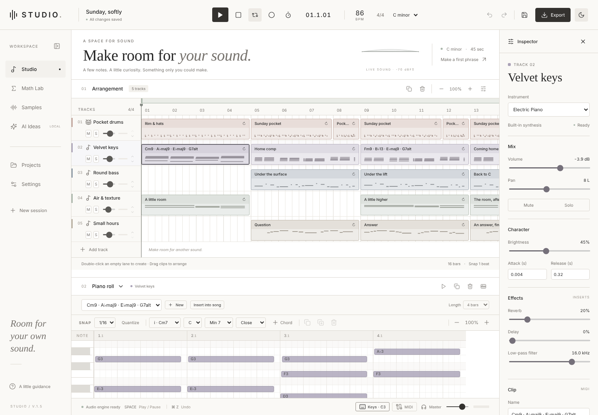

# STUDIO

**A quiet space to create your own sound.**

**[Open STUDIO — Live Website →](https://studio-music-yvette.yvettewu2017.chatgpt.site)**

Publicly accessible in your browser. No login or installation required. Click **Play** to start audio.

The live website currently runs the previously deployed STUDIO version. This repository contains the updated 1.1 source, which has not yet been deployed to that website.

A working browser music studio for composing original R&B, neo-soul, electronic music, and beats. Built with React, strict TypeScript, Tone.js, and Web Audio. No account, paid samples, or AI credentials are needed.



## Run locally

Use Node.js 22.12+ and npm 10+.

```sh
npm ci
npm run dev
```

Open the printed localhost URL (normally `http://127.0.0.1:5173`). Click Play to activate browser audio. Use headphones or keep your output volume comfortable.

```sh
npm run build       # strict TypeScript + production Vite build
npm run preview     # serve the production build
npm test            # domain, editing, persistence, and audio unit tests
npm run test:e2e    # Chrome browser tests, including real audio and WAV analysis
npm run format      # format source and documentation
```

Browser tests use the installed Google Chrome. For bundled Playwright Chromium, remove `channel: 'chrome'` in `playwright.config.ts`, then run `npx playwright install chromium`.

## Make a composition

1. The first session opens **Sunday, softly**, an editable 16-bar neo-soul arrangement at 86 BPM: drums, electric piano, bass, pad, and a plucked hook, in four sections (intro, home, lift, close). Press **Play** or Space to hear it. Open **Projects → Create blank project** to start from scratch at 90 BPM.
2. Set the project title, BPM, and musical key in the transport. Key selection highlights the scale and informs new ideas; it never transposes your existing notes.
3. Choose **Add track → Drum Kit**. Toggle the 16 drum steps, set swing, and Alt-click a hit to change its velocity. The editor's Play button previews the pattern in a continuous native-audio loop. Stop preview before returning to the arrangement.
4. Add **Electric Piano**. Click the piano grid to draw notes. Drag notes in time or pitch, drag their right edge to change duration, and Shift-click or Shift-drag to select multiple notes. Use the snap menu, quantize button, and velocity slider. The chord menu lists the seventh chords that belong to the project key (i · Cm7, iv · Fm7, V · G7…) and inserts them in the voicing you choose: close, open, rootless, or shell. Right-click a note to delete it. Scale rows and note names follow the key, so C minor shows E♭ and B♭ rather than D♯ and A♯.
5. Add **Felt Piano**, **Synth Bass**, **Sub Bass**, **Synth Pad**, **Lead Synth**, or **Pluck** for more voices. Each preset starts with a level, reverb, and delay chosen to sit with the others. The optional bottom keyboard auditions notes without recording them.
6. Arrange clips by dragging them along the timeline. Drag a clip's right edge to trim or extend it. A clip with **Loop source** enabled repeats its source pattern; otherwise an extended clip plays the pattern once and then remains silent. Double-click empty MIDI/drum lanes to create clips.
7. **New** creates a pattern independently of the song. **Insert into song** places it at the playhead. Duplicated clips share the original pattern; use **Inspector → Make independent** before editing a separate variation.
8. Use track **M**/**S**, volume, and Inspector pan, instrument parameters, reverb, delay, and low-pass filter to mix. Reverb and delay are sends into one shared room and one tempo-synced ping-pong delay, so tracks sound like they share a space. Edits made while the song plays take effect without stopping it. Settings contains the arrangement loop start/end; the ruler seeks the playhead.
9. Open **Samples** to preview six original WAV sounds or import WAV/MP3/other browser-decodable audio. Add a sample to an audio track, then trim its source start, set its gain, move it, or loop it. The arrangement shows its actual source waveform.
10. Open **AI Ideas** for three local, editable alternatives. Basslines, melodies, and chord voicings read the chords already in your song at the playhead and follow them (the description says "Follows Cm9 · A♭maj9 · …"); in an empty project they suggest the key's own progression instead. Drum ideas are two-bar grooves with ghost notes and a turnaround, chosen for the tempo. Rhythm variations and phrase continuations work from the selected clip. Preview an idea and choose **Use idea** to add a separate track. Your original notes stay intact.

## Save and reopen

Project changes autosave after 700 ms to IndexedDB. **Save** writes immediately. Wait for **All changes saved** before closing the page. **Projects** lists sessions, opens them, creates new ones, and deletes sessions with a confirmation. Reloading restores the last session and its imported audio from the same browser/origin.

Use **Download project JSON** for a portable notes/settings backup. JSON backups reference imported audio but **do not embed its bytes**; keep copies of your imported audio. Clearing browser data, changing browser profiles, or moving to another website origin will not transfer your local sessions. Export a WAV and a JSON backup before clearing browser storage.

## Export audio

Choose **Export → Export WAV**. The offline renderer exports the full arrangement, including audible tracks, mute/solo state, clip timing, instruments, volume/pan, effects, and imported audio. The playback loop region does not shorten the export.

Output is stereo **44.1 kHz / PCM 16-bit WAV**, with a two-second release/effect tail. Missing audible audio assets produce an explicit error. Rendering is limited to ten minutes including the tail to bound browser memory. MP3 export is not implemented.

## Deploy

`npm run build` writes a static site to `dist/`. Asset paths are relative, so the folder can be served from a domain root or from a sub-folder such as a GitHub Pages project site without extra configuration.

## Themes and shortcuts

The moon/sun button switches between exactly two themes: **Gallery Light** (default) and **Dark**. Theme preference is stored locally and does not restart audio or change musical state. Muted Morandi colors identify tracks and clips.

- **Space**: play/pause; transport Stop returns to the beginning.
- **⌘/Ctrl Z** and **⇧⌘/Ctrl Z**: undo/redo.
- **⌘/Ctrl C/V/D**: copy/paste/duplicate notes in the focused piano editor, or selected clips elsewhere.
- **Delete/Backspace**: delete selected notes in the editor, or a selected clip elsewhere.
- **⌘/Ctrl S**: save. **Escape**: clear note selection or close a panel.
- Arrow keys nudge selected notes; Shift+Up/Down moves an octave.

Shortcuts leave text inputs alone. Editing is desktop-first; narrow windows collapse navigation and allow panel/timeline scrolling.

## Optional AI integration

The application works without external AI. `src/ai/provider.ts` defines a provider interface and a server-endpoint adapter. A future LLM integration must live behind a server route, return the shared validated note schema, and keep provider credentials server-side. No API key belongs in Vite environment variables or client code. Nothing currently sends compositions to an AI service.

## Architecture and verification

- [What changed in 1.1, with measurements](docs/CHANGES.md)
- [Architecture and musical rules](docs/ARCHITECTURE.md)
- [Verified behavior and limitations](docs/VERIFICATION.md)
- [Original sample provenance](public/samples/README.md)

The MVP has real editing, realtime sound, offline rendering, local project storage, sample import, and local inspiration. It is not a replacement for a professional desktop DAW: recording, MIDI hardware, audio time-stretch, arbitrary time signatures, automation lanes, and cloud collaboration are future work.
