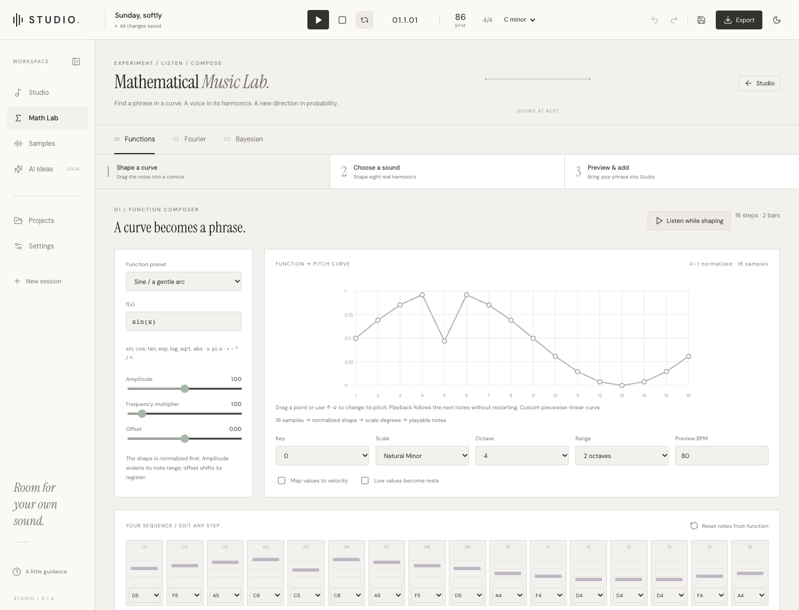

# Mathematical Music Lab — v1.4

A working workspace inside STUDIO: **Studio | Math Lab**, with **Functions | Fourier | Bayesian** tabs. It uses the existing project store, timeline, piano roll, audio clock, mixer, undo history, theme, and IndexedDB project storage. No service, API key, account, or paid sample is required.



## Use it

### Functions

Enter `sin(x)`, `sin(2*x) + 0.5*cos(5*x)`, or `exp(-x/5)*sin(4*x)`, or choose a preset. Adjust amplitude, frequency and offset; choose the key, scale and octave range. Defaults are D natural minor, 80 BPM, 16 eighth-note steps across two bars. Major, natural minor and minor pentatonic are supported.

The graph shows 16 normalized control points, connected as a piecewise-linear pitch contour. Drag a point (or focus it and use Up/Down, Home/End) to change its note. The first gesture starts audio. **Listen while shaping** also starts/stops the loop. Changes affect future notes without restarting the clock; already sounding notes retain their natural releases. The audio scheduler looks ahead by 60 ms, so an imminently scheduled note may still use its previous value. Each step's note selector edits the generated sequence or makes a rest. Optional mappings use the curve for velocity or sparse rhythm. **Play melody** loops the current sequence; **Stop** cancels playback, including a preview still being prepared. **Add to Studio** copies editable notes to a new selected track at the playhead, snapped down to a bar. A populated Studio keeps its tempo; an empty session adopts the preview tempo. Studio's key label is not changed or used to transpose the copied notes. Changing shape controls regenerates the sequence; key/scale controls remap a custom curve while preserving its shape, and changing BPM preserves note edits.

The three-step strip guides you from **Shape a curve** to **Choose a sound** to **Preview & add**. **Continue this curve with probability** copies the opening into Bayesian without counting generated notes as learned evidence.

### Fourier

Adjust eight harmonic amplitudes and watch the composite waveform. Five starting sounds are included: Pure Sine, Warm Soul Keys, Soft Synth Pad, Bright Electronic Lead, and Deep Bass. Attack, release and volume are editable. These are additive synthesizer approximations.

Hold a virtual piano key with mouse/touch, or focus a key and hold Space/Enter. **Hold tone** sustains the selected note while using sliders; **Release tone** or **Stop all sound** releases it. Tab changes, focus loss, workspace changes and the Studio Stop button silence the lab. Each held voice also has a 30-second audio-clock cutoff.

**Use this sound for my curve** returns to Functions, preserves the notes and selects the current Fourier instrument.

**Save sound** stores a named harmonic preset locally. It appears in the Studio Inspector's instrument menu under **Your Math Lab sounds**. Choose a destination to apply the current sound to an existing melodic track, or add a new blank instrument track and draw notes in its piano roll. Function/Bayesian previews can also use the current Fourier sound; their Add button carries that sound into Studio. The Fourier volume is a live audition control; Studio tracks use their normal mixer faders.

### Bayesian

Choose a key, scale, chord degree, previous note, length (8, 16 or 32), and exploration amount. Probability bars show the underlying posterior; vertical markers and “draw” percentages show the separate sampling distribution. Click a candidate to choose it manually, or **Suggest next note**, then **Accept** or **Reject**.

Accept appends a note while the phrase has room and records one observation. A full phrase can still receive learning feedback without changing its notes. The message shows the before/after probability in the context where the suggestion was made; the next context uses the accepted note as its previous degree. Reject records a preference in that original context without inventing negative Dirichlet counts. **Generate 16 notes** fills a phrase from the model without training on its own output. Edit step notes, preview, and send the result into Studio. **Clear melody** clears only the phrase; **Reset learned preferences** clears the local evidence.

## Models and audio

- **Expression language:** a bounded recursive-descent arithmetic parser, with an explicit function/operator allowlist. There is no `eval`, `Function`, property access, assignment, object construction, or general code execution. Expressions are limited to 256 characters, 128 tokens and 24 nested parentheses/functions; non-finite evaluations produce an error, and extreme finite results are clamped to ±1,000,000.
- **Function mapping:** sample `f(k × 2πi/16)` for i = 0…15. Min/max normalization maps the shape to [0,1], with constant functions mapped to 0.5. Apply amplitude as contrast around 0.5 and offset as a register shift, then clamp again. This ordering prevents amplitude and offset from cancelling during normalization. Round the result to an index in the selected scale/octave note list. The editable graph shows the 16 normalized samples. Dragging overrides them with a custom control curve; changing expression/shape controls resets the curve.
- **Fourier model:** `x(t) = Σ Aₙ sin(2πnf₀t)`, eight harmonics with fixed zero phase. Divide amplitudes by `max(1, ΣA)` to bound the waveform while preserving low amplitudes and all-zero silence. Sequenced/offline notes use Web Audio `PeriodicWave`; live held notes use equivalent phase-aligned sine partials whose gains glide over 18 ms. Both use STUDIO's existing audio context, and live notes route through its master bus. Sequenced harmonics above the Nyquist limit are omitted. The implementation follows the [Web Audio PeriodicWave coefficient contract](https://developer.mozilla.org/en-US/docs/Web/API/PeriodicWave/PeriodicWave).
- **Bayesian model:** context is `(root, scale, chord degree, previous degree)`. Handcrafted positive prior pseudocounts favor nearby degrees and the degree-based chord tones. `P(i | evidence) = (αᵢ + acceptedᵢ) / Σ(αⱼ + acceptedⱼ)`. Accepted choices update exactly one count in the suggestion's original context.
- **Rejection / exploration:** multiply posterior weights by `exp(−0.35 × min(rejectedᵢ,50))`, renormalize, then mix with uniform probability using the exploration slider. This is an explicit preference heuristic followed by exploratory sampling, not a conjugate Bayesian update. Rejection does not change the displayed posterior. Automatic generation uses a reproducible seed and never counts generated notes as user evidence.
- **Audio-reactive artwork:** a 1024-sample Web Audio analyser reads the actual post-master output. Waveform samples and frequency-bin amplitudes drive SVG paths at up to 30 fps (about 7 fps for reduced motion). No beat or motion is simulated while silent. The caption is a short-window RMS dBFS reading, not integrated loudness.
- **Shared representation:** normal `MidiNote` values (`pitch`, `startTick`, `durationTicks`, `velocity`) inside Studio `Pattern` objects. No second sequencer or ordinary browser timer schedules musical notes.

## Persistence and compatibility

Versioned, bounded, Zod-validated localStorage (`studio.math-lab.v1`) saves the workspace/tab, settings, edited sequences, Fourier configurations/presets, musical context and learned counts. Corrupted, oversized or incompatible data safely falls back to defaults. Storage write failures are visible. Studio project data remains in its existing IndexedDB database; applied instruments carry their own eight amplitudes and optional preset name, so project JSON backup and reload preserve the sound. Existing schema-version-1 projects remain valid without the new optional fields.

Lab preferences and unused saved presets are local to the browser/origin and are not included in project JSON or complete project backups. Add a sound/sequence to a project to include it in that project's backup. There is no cloud synchronization.

## Implementation map

Modules:

- `src/math/expression.ts`: bounded expression parsing/evaluation.
- `src/math/curve.ts`, `src/components/math/CurveEditor.tsx`: control-point editing and scale mapping.
- `src/components/math/MathLabControls.tsx`: shared sliders, key/scale selectors, graphs and sequences.
- `src/components/SessionArtwork.tsx`: measured audio visualization.
- `src/math/functions.ts`: normalization, scale/MIDI mapping and sequence generation.
- `src/math/fourier.ts`: harmonic presets, normalization and waveform samples.
- `src/math/bayesian.ts`: priors, posterior, feedback and melody sampling.
- `src/math/studio.ts`: small undo-compatible track/pattern/instrument adapter.
- `src/stores/mathLabStore.ts`: versioned persistence and recovery.
- `src/components/MathLab.tsx`, `src/themes/math-lab.css`: integrated interactive workspace and two-theme styling.
- `src/math/math.test.ts`, `e2e/math-lab.spec.ts`: mathematical, persistence, integration and actual browser-audio checks.

Modified modules: `src/app/App.tsx` (navigation and adapter calls), `src/components/Inspector.tsx` (saved sound selection), `src/domain/models.ts` / `validation.ts` (Fourier instrument metadata), `src/audio/graph.ts` / `engine.ts` (sequenced and live synthesis), `src/main.tsx` (development-only read-only test hooks), package version metadata, README, release/verification notes and screenshots.

## Run and validate

Use Node 22.12+ and npm 10+. From the repository:

```sh
npm ci
npm run dev
npm test
npm run build
npm run test:e2e
```

Local browser tests use installed Google Chrome. In CI, install Playwright Chromium and run with `CI=1`. No lint script is configured; strict TypeScript and the existing formatter are used.

Automated coverage includes expression rejection and normalization, scale/MIDI conversion, real posterior updates and context isolation, bounded harmonic generation, safe persistence recovery, detached track insertion, editable sequences, accept/reject feedback persistence, both themes, keyboard note-on/off, live harmonic changes, stop while activation is pending, and actual offline harmonic spectrum comparison. Existing Studio tests also exercise editing, imported audio, WAV export, saving and playback. See [VERIFICATION.md](VERIFICATION.md) for the final run results.

Browser signal checks establish actual sound output, frequency-content changes, and silence after stopping. They are not a human listening assessment. Safari/Firefox, mobile touch combinations and long-session stress are not independently certified.

## Deliberate MVP boundaries and useful next steps

The function language is intentionally small; there are no user-defined functions or arbitrary programs. Fourier has eight amplitudes and fixed phases, with no sampled acoustic library. Bayesian context is a compact scale-degree model, not a trained composer, and one chord degree applies to each generated phrase. Phrase length is bounded; there is no cloud model, collaboration, VST hosting, or external AI.

Prioritized improvements: (1) browser/mobile audio validation and touch ergonomics; (2) export/import of the complete lab preset/evidence library; (3) richer chord progressions and a small feedback-history inspector; (4) optional harmonic phases and more expression presets.
